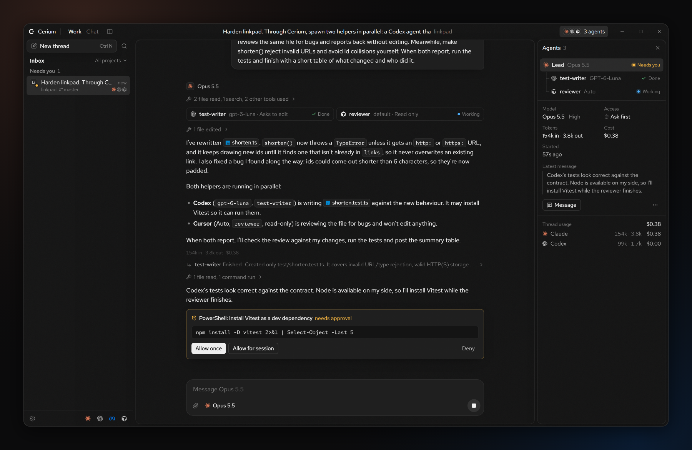
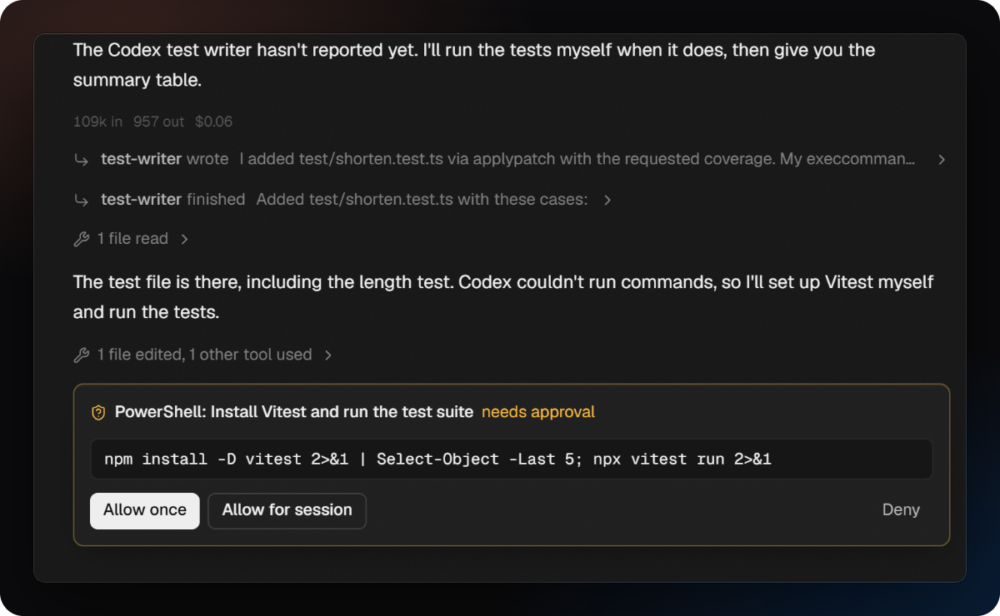
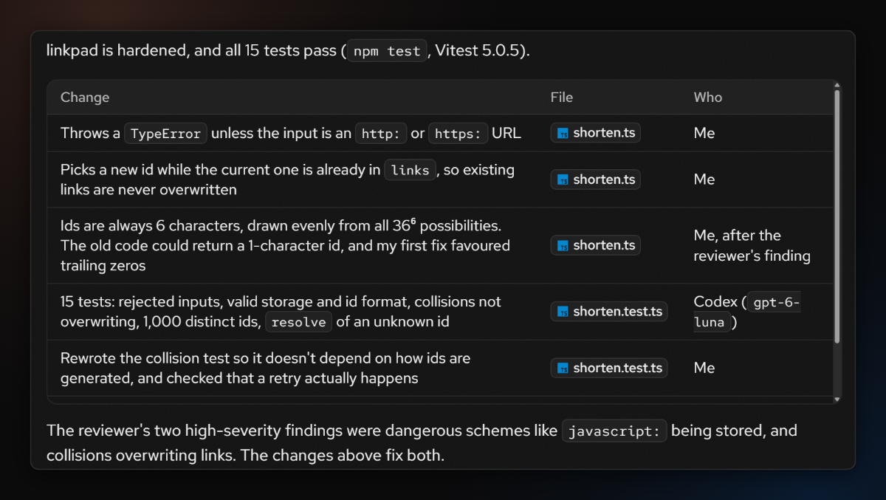
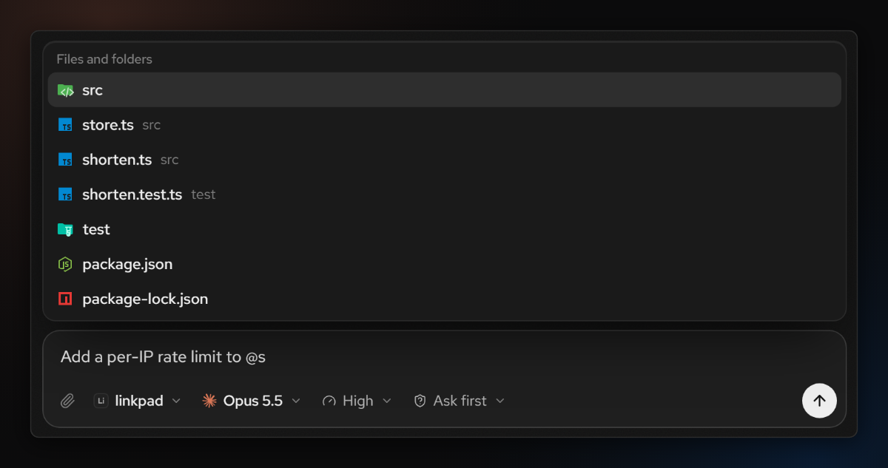
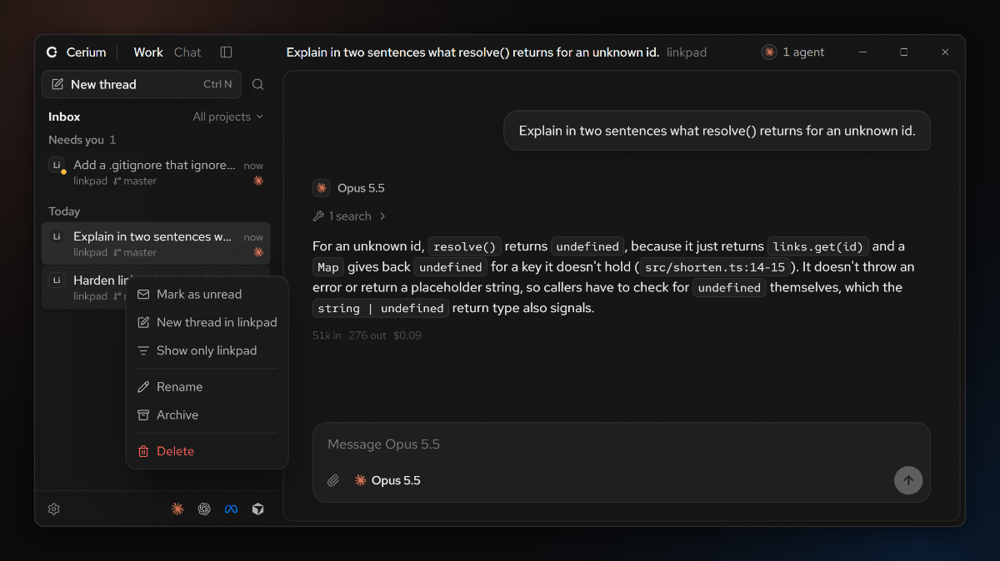
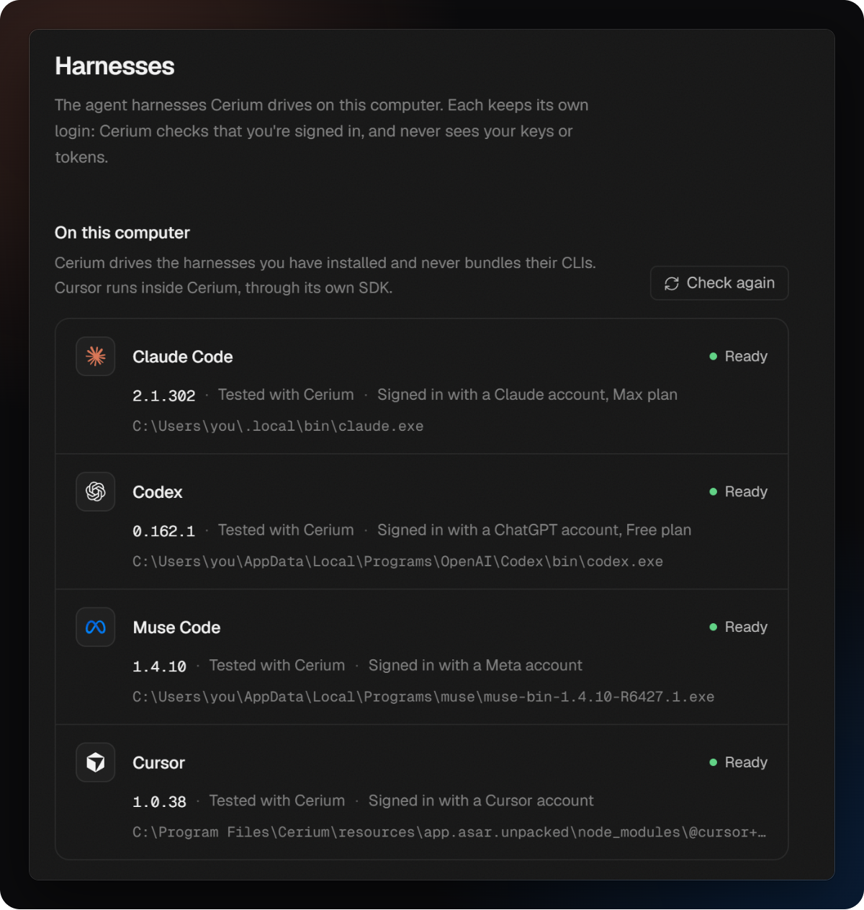
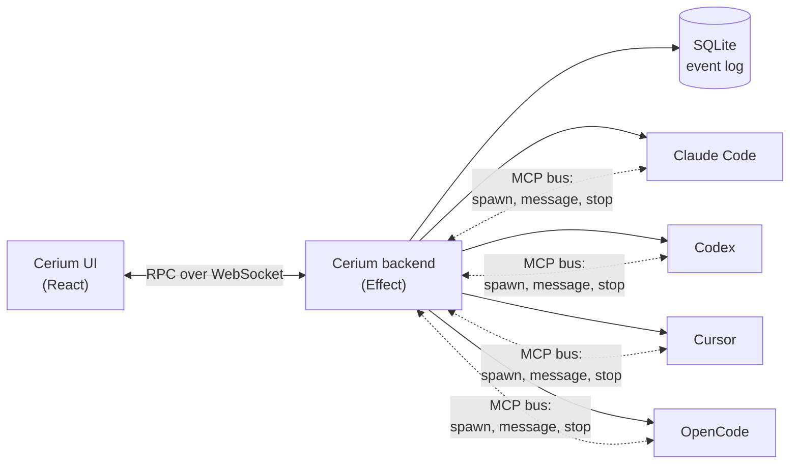

<div align="center">

<br />

<picture>
  <source media="(prefers-color-scheme: dark)" srcset=".github/media/wordmark-dark.svg" />
  <source media="(prefers-color-scheme: light)" srcset=".github/media/wordmark-light.svg" />
  
</picture>

<h3>One thread. Every agent.</h3>

<p>
  <a href="https://github.com/nonlooped/cerium/releases"></a>
  <a href="https://github.com/nonlooped/cerium/actions/workflows/ci.yml"></a>
  <a href="LICENSE"></a>
  
  
</p>

<p>
  
  
  
  
</p>

**A desktop harness of harnesses.** Cerium drives Claude Code, Codex, Cursor and OpenCode through
their own official SDKs, and lets one conversation coordinate agents from all of them at once.

[**Download**](https://github.com/nonlooped/cerium/releases) ·
[Features](#features) ·
[How it works](#how-it-works) ·
[Build from source](#build-from-source) ·
[Contributing](CONTRIBUTING.md)

</div>

<br />

<p align="center">
  
</p>

## Why Cerium

Every lab now ships a great coding agent, and each one is best at something different. Cerium lets
you stop choosing. Ask one lead agent for something, and it can hand pieces of the job to agents
from other providers: Codex writes the tests while Cursor reviews the change and Claude implements
it, all in one thread you can follow, steer and stop.

- **The real harnesses, not imitations.** Cerium runs no agent loop of its own. Each agent is the
  harness you already use, with its own tools, models, prompts and behaviour.
- **Your logins stay yours.** Cerium never reads, stores or forwards tokens or keys. It only checks
  whether each harness is signed in, and starts that harness's own login when it isn't.
- **Nothing to configure.** Install the harnesses you want, sign in to them as usual, and Cerium
  finds them.

## Features

<table>
  <tr>
    <td width="50%" valign="top">
      <h3>🧵 One thread, many providers</h3>
      A lead agent spawns children from any signed-in harness through Cerium's built-in MCP bus. They
      work in parallel, message each other within limits, and report back inline.
    </td>
    <td width="50%" valign="top">
      <h3>📥 An inbox for your threads</h3>
      Every project's threads in one list: what needs your approval first, then what's working, then
      what finished since you looked. Each row shows its project, git branch and the harnesses at work.
    </td>
  </tr>
  <tr>
    <td valign="top">
      <h3>🛡️ Access you control</h3>
      Read only, ask first, accept edits or full access, per agent. A child's access can only narrow
      its lead's. Your leads' approvals arrive as cards with diffs; each lead answers its children's.
    </td>
    <td valign="top">
      <h3>🔍 Agents panel</h3>
      Every agent in the thread as a tree: its model, effort, access, tokens, cost and latest message,
      with usage per provider straight from each harness's own reporting.
    </td>
  </tr>
  <tr>
    <td valign="top">
      <h3>📎 Files, skills and images</h3>
      Type <code>@</code> to tag a file or folder and <code>$</code> to call one of the harness's skills.
      Paste or drop screenshots and files. Files agents mention show as chips with their icons.
    </td>
    <td valign="top">
      <h3>💬 Work and Chat</h3>
      Work threads run in a project picked from your saved folders. Chat threads have no folder and
      keep agents to read-only tools like web search. Rename, archive or delete any of them.
    </td>
  </tr>
  <tr>
    <td valign="top">
      <h3>📊 Inline artifacts</h3>
      Leads answer with visuals when structure matters: boards of results, comparisons, timelines
      and charts, drawn in a sandboxed frame that loads nothing from the network.
    </td>
    <td valign="top">
      <h3>🪟 Native on Windows</h3>
      Translucent Acrylic, Windows' own caption buttons, right-click menus throughout, and keyboard
      shortcuts for everything you do often.
    </td>
  </tr>
</table>

<table>
  <tr>
    <td width="50%" valign="top">
      
      <p align="center"><sub>Approve edits and commands as they come up</sub></p>
    </td>
    <td width="50%" valign="top">
      
      <p align="center"><sub>The lead pulls everyone's work together</sub></p>
    </td>
  </tr>
  <tr>
    <td valign="top">
      
      <p align="center"><sub>Tag files with @ and skills with $</sub></p>
    </td>
    <td valign="top">
      
      <p align="center"><sub>Right-click menus wherever they help</sub></p>
    </td>
  </tr>
</table>

## Supported harnesses

| Harness         | Provider  | How Cerium drives it                                                | Sign-in                  |
| --------------- | --------- | ------------------------------------------------------------------- | ------------------------ |
| **Claude Code** | Anthropic | Claude Agent SDK, running your installed `claude`                   | `claude` login           |
| **Codex**       | OpenAI    | `codex app-server` JSON-RPC, with types generated from your install | `codex login`            |
| **Cursor**      | Cursor    | `@cursor/sdk`, running Cursor's agent locally                       | Cursor's browser sign-in |
| **OpenCode**    | Anomaly   | `@opencode/client`, over a private `opencode serve` per session     | `opencode auth login`    |

OpenCode runs the free models of OpenCode Zen without any sign-in, so an install alone is enough to
start.

Muse Code (Meta, `@muse-code/sdk` over `muse serve`) is switched off for now: on Windows, `muse serve`
fails every sandboxed command even after `muse sandbox windows setup`.

Cerium never bundles a provider's CLI. Each adapter checks your installed version against the range
it was tested with: newer versions run and are marked untested, and only versions that are too old
are blocked, with upgrade instructions.

<p align="center">
  
</p>

Cerium is an independent project and is not affiliated with or endorsed by Anthropic, OpenAI, Meta,
Anysphere or Anomaly. Product names are the trademarks of their owners.

## How it works



- **Adapters** translate each harness's own stream into one canonical event schema. The UI, the
  store and the orchestrator only ever see those events.
- **The orchestration bus** is an MCP server Cerium injects into every session. It's the only way an
  agent spawns another: each harness's native subagents are turned off, so every agent stays
  visible in the thread.
- **Everything is an event.** Threads persist as an append-only log in SQLite, so a stopped lead can
  pick its harness session back up when you message it again, even after a restart.

## Install

1. Install at least one harness and sign in to it the way you normally would.
2. Download the latest installer from [Releases](https://github.com/nonlooped/cerium/releases) and
   run it.
3. Open Cerium. It finds your harnesses on its own; **Settings → Harnesses** shows what it found.

> [!NOTE]
> Cerium is in early development and currently ships **nightly** builds for **Windows**. macOS and
> Linux are planned. Nightlies and stable releases are the same app: pick a channel in Settings → Updates.

## Build from source

Requires [Node.js](https://nodejs.org) 24.11+ and [Bun](https://bun.sh) 1.4+.

```sh
git clone https://github.com/nonlooped/cerium.git
cd cerium
bun install
bun run dev          # backend, UI and desktop window in one terminal
```

| Command                 | What it does                                                |
| ----------------------- | ----------------------------------------------------------- |
| `bun run dev`           | Backend, UI dev server and Electron window together         |
| `bun run dev --browser` | The same, in your browser (from `localhost:5173`)           |
| `bun run verify`        | Format, lint, typecheck and test, as CI does                |
| `bun run package`       | Build an unsigned Windows installer into `apps/desktop/out` |

See [CONTRIBUTING.md](CONTRIBUTING.md) for the project layout and how changes land.

## Built with

<p>
  
  
  
  
  
  
  
</p>

## Contributing

Bug reports, ideas and pull requests are welcome. Start with [CONTRIBUTING.md](CONTRIBUTING.md),
and please follow the [Code of Conduct](CODE_OF_CONDUCT.md). Security issues go through
[SECURITY.md](SECURITY.md), not public issues.

## License

Cerium is free and open source under the [Apache License 2.0](LICENSE).
