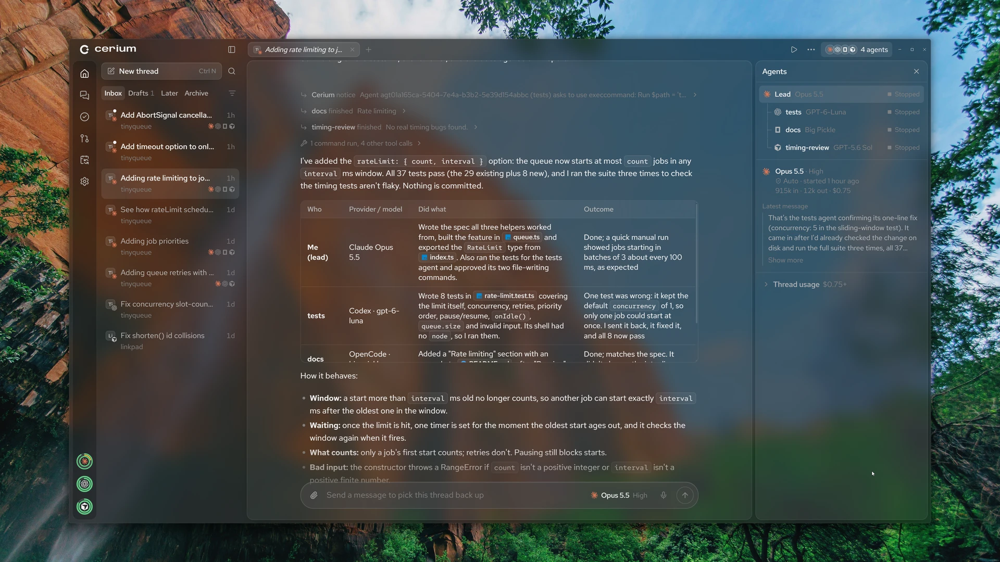
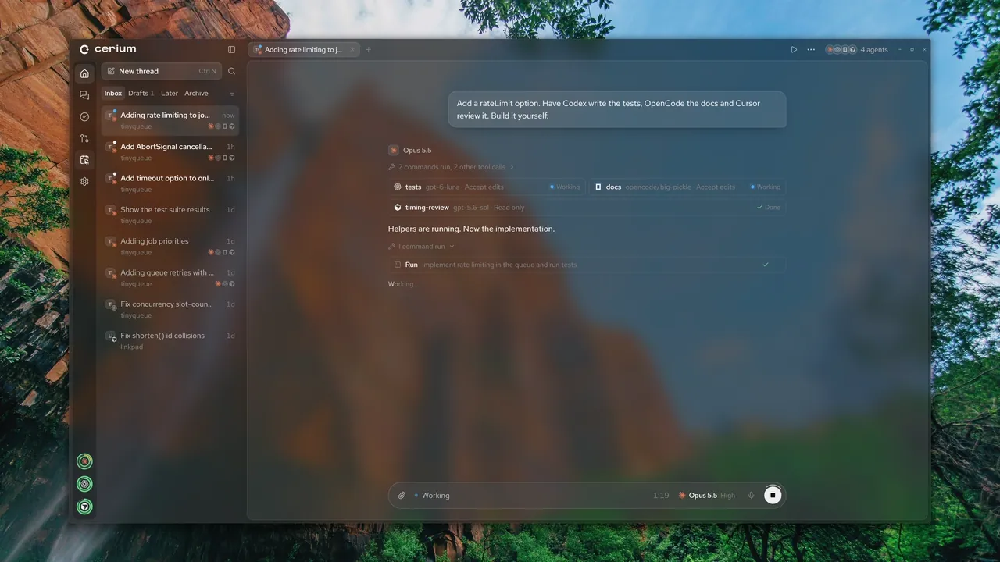
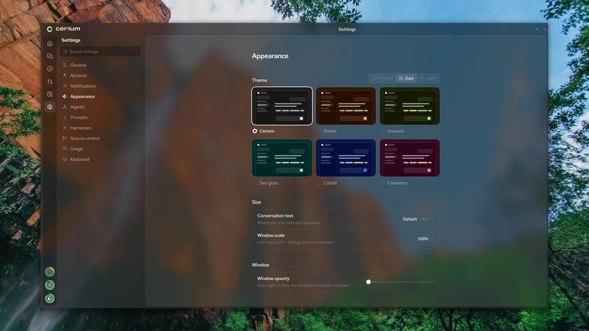
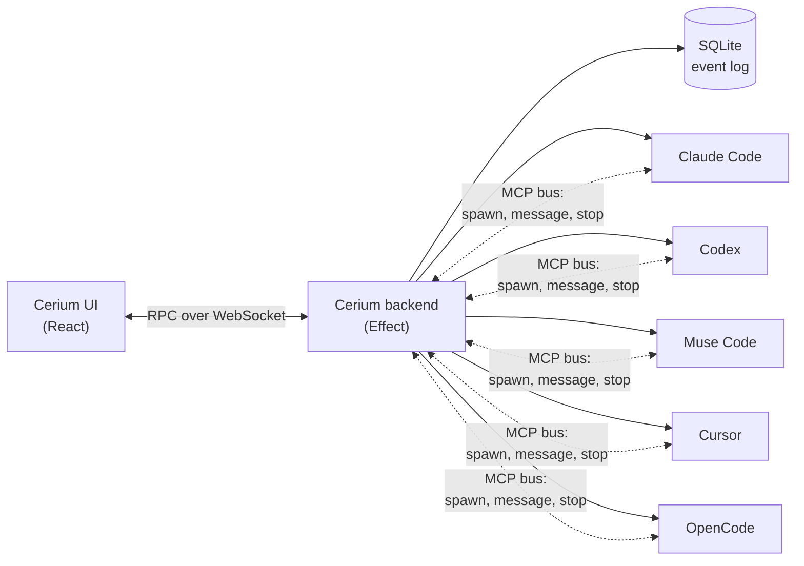

<div align="center">

<br />

<picture>
  <source media="(prefers-color-scheme: dark)" srcset=".github/media/wordmark-dark.svg" />
  <source media="(prefers-color-scheme: light)" srcset=".github/media/wordmark-light.svg" />
  
</picture>

<h3>Your coding agents, working as one team.</h3>

<p>
  <a href="https://github.com/CeriumHQ/cerium/releases"></a>
  <a href="https://github.com/CeriumHQ/cerium/actions/workflows/ci.yml"></a>
  <a href="LICENSE"></a>
  
</p>

<p>
  
  
  
  
  
</p>

Ask once. A lead agent splits the job across Claude Code, Codex, Cursor, OpenCode and Muse Code, the
helpers work in parallel and talk to each other, and you get one answer back.

[**Download**](https://github.com/CeriumHQ/cerium/releases/latest) ·
[Website](https://cerium.nonlooped.xyz) ·
[Build from source](#build-from-source)

</div>

<br />

<p align="center">
  
</p>

## One prompt, a whole team

Every model is good at something. Cerium lets them work together instead of taking turns in five
terminals.

- **The lead splits the work.** It spawns helpers on any harness you're signed in to, each with the
  model and access the job needs.
- **Helpers talk to each other.** They message the lead and one another, and say so before touching a
  file someone else is editing.
- **You get one report.** Who did what, on which model, and what came of it, in the thread you started.

<p align="center">
  
</p>

## A second opinion from another lab

Claude wrote it? Have Codex review the diff before you commit. **Review** asks a model from a different
harness than the one that made the change, so the reviewer doesn't share the author's blind spots. Its
findings land as comments on the diff's lines, one click from going back to the agent.

Plan running dry mid-task? **Continue on another harness**: Cerium offers it when a limit runs low, and
the thread carries on there with the conversation, the files it changed and its plan.

## Answers you can play with

Agents answer with charts, timelines and what-ifs drawn right in the conversation, on your theme.
Drag a slider and the page reruns; click its button and your reply is written for you.

<p align="center">
  
</p>

## Fixes CI while you're away

Automations start threads on a schedule, or **when CI fails** on a commit an agent pushed: a thread
starts with the failed checks' logs and your standing orders, say "find why CI failed, fix it and
push". Your phone hears about it when it's done.

<p align="center">
  
</p>

## Everything else a day of agent work needs

<table>
  <tr>
    <td width="33%" valign="top"><b>Undo any turn</b><br />Take the thread, and its files, back to before any message.</td>
    <td width="33%" valign="top"><b>Terminal and browser</b><br />Each thread has its own shells and a browser its agents can drive.</td>
    <td width="33%" valign="top"><b>Git and GitHub</b><br />Stage, commit and work through pull requests and issues beside the thread.</td>
  </tr>
  <tr>
    <td valign="top"><b>From your phone</b><br />Sign in and your computer's threads come along, with a ping when an agent needs you.</td>
    <td valign="top"><b>Side by side</b><br />Split the window into panes, or send one prompt to four models and compare.</td>
    <td valign="top"><b>Bring your sessions</b><br />Import the Claude Code, Codex, OpenCode and Muse sessions you already have.</td>
  </tr>
</table>

<p align="center">
  
</p>

## Your harnesses, on your plans

Each agent is the real harness, driven through its official SDK on your own subscription. Cerium
starts each harness's own sign-in and never reads its tokens or keys.

| Harness         | Driven through                                      | Sign in                  |
| --------------- | --------------------------------------------------- | ------------------------ |
| **Claude Code** | Claude Agent SDK, running your installed `claude`   | `claude` login           |
| **Codex**       | `codex app-server`, with types from your install    | `codex login`            |
| **Muse Code**   | `@muse-code/sdk`, over a private `muse serve`       | `muse login`             |
| **Cursor**      | `@cursor/sdk`, running Cursor's agent locally       | Cursor's browser sign-in |
| **OpenCode**    | `@opencode/client`, over a private `opencode serve` | `opencode auth login`    |

Install any of them and sign in as usual; Cerium finds them. OpenCode's free models need no sign-in.
On Windows, Muse runs commands with Full access only for now: `muse serve` can't sandbox them there.
Cerium is an independent project, not affiliated with or endorsed by Anthropic, OpenAI, Meta,
Anysphere or Anomaly.

<details>
<summary><b>How it works</b></summary>

<br />



Adapters translate each harness's stream into one event schema, stored as an append-only log. Cerium
runs no agent loop of its own: agents spawn and message each other only through an MCP server it
injects into every session, so every agent stays visible in the thread.

</details>

## Install

Download the [latest stable release](https://github.com/CeriumHQ/cerium/releases/latest):

- **Windows 10 and 11**: run `Cerium-Setup-<version>-x64.exe`, or `-arm64.exe` on an Arm PC. The
  installer isn't code-signed yet, so SmartScreen warns that it "protected your PC": choose More info,
  then Run anyway.
- **macOS**: open `Cerium-<version>-arm64.dmg` on Apple silicon, or `-x64.dmg` on an Intel Mac, and
  drag Cerium into Applications. Until it is notarized, open it once, then choose Open Anyway in
  System Settings → Privacy & Security.
- **Ubuntu and Debian**: `sudo apt install ./cerium_<version>_amd64.deb` (`arm64` on Arm).
- **Fedora**: `sudo dnf install ./cerium-<version>.x86_64.rpm` (`aarch64` on Arm).
- **Any other Linux**: `chmod +x Cerium-<version>-x86_64.AppImage` (`arm64` on Arm) and run it. It
  needs FUSE 2 (`libfuse2`, or `libfuse2t64` on Ubuntu 24.04 and later).

Stable releases are tested and come out when something worth shipping has landed. Cerium also
publishes **nightly** builds of every change as it lands, marked as pre-releases on the
[Releases](https://github.com/CeriumHQ/cerium/releases) page. They are for trying things early and can
ship rough edges, so most people should stay on stable. The app updates itself on the channel you pick
in Settings → Updates.

## Privacy

Cerium collects no usage data. Your threads live in a SQLite database on your machine, and each harness
talks to its own provider as it does without Cerium. When something in Cerium crashes, it sends an
anonymous crash report, which you can turn off.

<details>
<summary>What Cerium itself reaches out for</summary>

<br />

- **Your Cerium account, if you sign in.** Signing in (through Clerk) lets your phone and other
  machines follow your threads. The relay at `cerium.nonlooped.xyz` then keeps, per account:
  your name, email and profile picture from the sign-in; each device's name, platform, Cerium
  version and update channel, when it was last seen, and a hash of its device key; a copy of every
  thread on your signed-in machines, its messages, tool calls and their output, without images;
  what you're drafting and when each thread was last read; and browsers' push subscriptions. While
  you use Cerium from another device, the relay also passes traffic between it and your machine.
  Signing a machine out, or removing it in Settings → Account, deletes its threads' copies, and
  deleting a thread deletes its copy. Clerk keeps your sign-in, and Cloudflare, which runs the relay,
  keeps its request logs.
- **Crash reports.** When Cerium fails (a view that can't be drawn, a backend that can't start or
  crashes, a harness session that fails unexpectedly, an update that can't install), the desktop app
  sends a report to [Sentry](https://sentry.io): the error's type, its message with every file path,
  web address, email address, IP address and id removed, and where in Cerium's own code it happened;
  Cerium's version and channel; your system, its version and your processor. Never your messages,
  files, folder or project names, thread titles, account, machine name or memory contents, and the
  project doesn't store the IP address a report comes from. The scrubbing is in
  [`apps/desktop/src/scrub.ts`](apps/desktop/src/scrub.ts). Turn it off in Settings → General → Send
  crash reports.
- **Updates.** The app checks this repository's GitHub Releases at launch and every six hours, and
  downloads an update only when you ask. Settings → Harnesses looks up each harness's newest version
  on npm or GitHub to tell you when one is out.
- **Dictation.** The speech model you pick downloads from Hugging Face on first use, and your voice is
  transcribed on your machine.
- **Artifacts.** Pages an agent draws can load scripts over HTTPS, such as the chart libraries
  Cerium suggests from `cdn.jsdelivr.net`, so viewing one may fetch from that CDN.

</details>

## Build from source

Requires [Node.js](https://nodejs.org) 24.11+ and [Bun](https://bun.sh) 1.4+.

```sh
git clone https://github.com/CeriumHQ/cerium.git
cd cerium
bun install
bun run dev      # backend, UI and desktop window; --browser for the UI in your browser
bun run verify   # format, lint, typecheck and test, as CI does
```

## Contributing

Bug reports, ideas and pull requests are welcome. Security issues go through a
[private advisory](https://github.com/CeriumHQ/cerium/security/advisories/new), not public issues:
see [SECURITY.md](SECURITY.md).

## License

Free and open source under the [Apache License 2.0](LICENSE).
