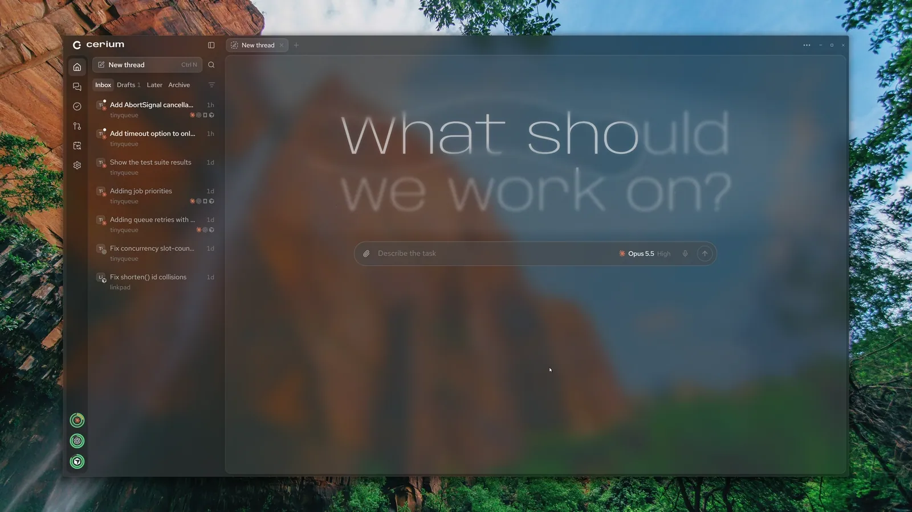
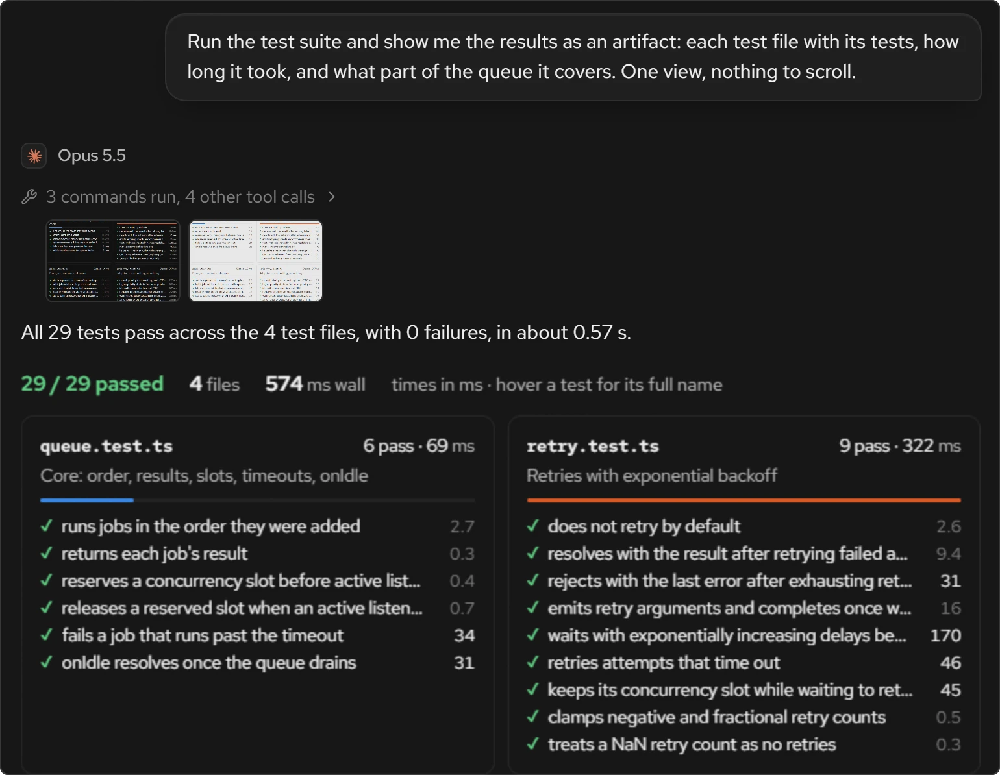
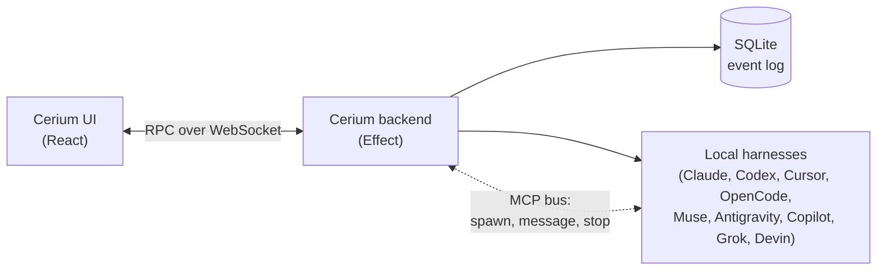

<div align="center">

<br />

<picture>
  <source media="(prefers-color-scheme: dark)" srcset=".github/media/wordmark-dark.svg" />
  <source media="(prefers-color-scheme: light)" srcset=".github/media/wordmark-light.svg" />
  
</picture>

<h3>One thread. Every agent.</h3>

<p>
  Local-first desktop app for running Claude Code, Codex, Cursor, OpenCode, Muse Code,
  Antigravity, GitHub Copilot, Grok Build, and Devin together on the plans you already pay for.
</p>

<p>
  <a href="https://github.com/CeriumHQ/cerium/releases/latest"></a>
  <a href="https://github.com/CeriumHQ/cerium/actions/workflows/ci.yml"></a>
  <a href="LICENSE"></a>
</p>

<p>
  <a href="#install"><b>Install</b></a> ·
  <a href="https://cerium.nonlooped.xyz">Website</a> ·
  <a href="CHANGELOG.md">Changelog</a> ·
  <a href="#build-from-source">Build from source</a>
</p>

</div>

<br />

<p align="center">
  
</p>

## Why Cerium

Every coding agent has strengths. Instead of juggling terminals or routing through a wrapper with API markup, Cerium drives your local harnesses on your existing subscriptions and lets them work together in one thread.

- **Multi-harness delegation** — A lead agent splits work across any harness you're signed in to, with scoped permissions. Helpers coordinate edits over Cerium's MCP bus, and every subagent transcript stays inspectable live.
- **Cross-lab review & failover** — Have another lab's model review a diff before you commit, with line comments one click from sending back to the agent. Hit a rate limit mid-task? Continue on another harness with your history, changes, and plan intact.
- **Interactive artifacts** — Agents render live HTML charts, timelines, and simulators directly in the thread. Adjust controls to test tradeoffs and send your settings straight back.
- **Automations & CI recovery** — Start threads on a schedule, on GitHub events, or automatically when CI fails — pulling failed logs, fixing the break, and pushing again.
- **Git, GitHub & checkpoints** — Durable git worktrees per thread, inline staging and commits, PR and issue workflows, and turn-level checkpoints that restore both conversation and files.
- **Terminals, preview & computer use** — Per-thread shells, an inspectable browser preview agents can drive (element picking, viewports, light/dark), and opt-in cross-harness computer use with live per-agent cursors.
- **Phone & remote access** — Optional sign-in syncs desktop threads to the web app and phone, with push notifications when an agent finishes or needs approval.
- **Daily ergonomics** — Thread forking, `/btw` side questions, split panes, local Whisper dictation, `cerium` CLI, remote MCP server, a shared Hub for MCP servers, skills, and project instructions, and session import from Claude Code, Codex, GitHub Copilot, OpenCode, and Muse.

<p align="center">
  
</p>

## Supported harnesses

Install any of these locally and sign in as usual — Cerium detects them automatically. Each harness handles its own auth; Cerium never reads your tokens or API keys.

| Harness            | Integration                           | Sign-in                                     |
| ------------------ | ------------------------------------- | ------------------------------------------- |
| **Claude Code**    | Claude Agent SDK (`claude`)           | `claude` login                              |
| **Codex**          | `codex app-server`                    | `codex login`                               |
| **Cursor**         | `@cursor/sdk`                         | Cursor browser sign-in                      |
| **OpenCode**       | `@opencode/client` (`opencode serve`) | `opencode auth login` _(free models: none)_ |
| **Muse Code**      | `@muse-code/sdk` (`muse serve`)       | `muse login`                                |
| **Antigravity**    | Antigravity CLI over ACP (`agy acp`)  | `agy acp --login`                           |
| **GitHub Copilot** | Copilot CLI over JSON-RPC             | `copilot login`                             |
| **Grok Build**     | Grok Build CLI over ACP               | `grok login`                                |
| **Devin**          | Devin CLI over ACP (`devin acp`)      | `devin auth login`                          |

<details>
<summary>Harness notes</summary>

- **Antigravity** requires CLI 1.5.0+, runs work threads with your existing MCP config enabled, and cannot enforce read-only mode (so it is unavailable for chat threads). Cerium directs it to delegate over the MCP bus, though its CLI has no flag to disable native subagents.
- **GitHub Copilot** uses manual approval prompts in Auto mode. It imports local CLI sessions and supports thread forks, `/btw`, and manual compaction. Hub server and skill switches apply across projects.
- **Cursor** uses the local Agent SDK's workspace-scoped sessions. The standalone Cursor CLI keeps a separate chat history. Cursor's Hub server switches apply per project.
- **Devin** runs each session on a copy of your Devin settings with native subagents turned off, so helpers coordinate over Cerium's MCP bus. Devin has no appendable system prompt over ACP, so Cerium's instructions open a thread's first turn.
- **Muse Code** supports native thread forks and exposes configured MCP servers and skills in the Hub. On Windows, it runs commands with Full access only, as `muse serve` cannot sandbox commands there.
- **OpenCode** answers `/btw` from the session's context. OpenCode 2.3.2 can also show background jobs and stop running shell jobs.

</details>

<details>
<summary>Architecture</summary>

<br />



Adapters normalize each harness's stream into one append-only SQLite event log. Cerium runs no agent loop of its own: agents coordinate strictly through an MCP server injected into each session, keeping every subagent visible in the thread.

</details>

## Install

Download the [latest stable release](https://github.com/CeriumHQ/cerium/releases/latest) (or via [cerium.nonlooped.xyz/downloads](https://cerium.nonlooped.xyz/downloads/)):

- **Windows 11 (x64)** — Run `Cerium-Setup-<version>-x64.exe` _(unsigned; confirm Windows SmartScreen if prompted)_.
- **macOS (Apple silicon)** — Open `Cerium-<version>-arm64.dmg` and drag Cerium to Applications _(unnotarized builds: open once, then allow in **System Settings → Privacy & Security**)_.
- **Linux (x64)** — `chmod +x Cerium-<version>-x86_64.AppImage` and launch _(requires FUSE 2: `libfuse2`, or `libfuse2t64` on Ubuntu 24.04+)_.

Nightly pre-releases are also published on [Releases](https://github.com/CeriumHQ/cerium/releases) for every change on `main`. Switch update channels anytime in **Settings → Updates**.

## Build from source

Requires [Node.js](https://nodejs.org) 24.11+ and [Bun](https://bun.sh) 1.4+.

```sh
git clone https://github.com/CeriumHQ/cerium.git
cd cerium
bun install
bun run dev      # backend, UI, and desktop window (--browser for browser UI only)
bun run verify   # format, lint, typecheck, and tests
```

## Privacy & security

Cerium is local-first and collects no telemetry or usage analytics. Threads live in a local SQLite database, and each harness communicates directly with its own provider. Account sign-in for remote/mobile access is optional. Anonymous crash reports are scrubbed before sending ([`apps/desktop/src/scrub.ts`](apps/desktop/src/scrub.ts)) and can be disabled in **Settings → General**. See the full [Privacy Policy](https://cerium.nonlooped.xyz/privacy/).

Contributions, bug reports, and pull requests are welcome. Report security vulnerabilities privately through [GitHub Security Advisories](https://github.com/CeriumHQ/cerium/security/advisories/new) — see [SECURITY.md](SECURITY.md).

## License

Open source under the [Apache License 2.0](LICENSE). Cerium is an independent project, not affiliated with or endorsed by Anthropic, OpenAI, Anysphere, Anomaly, Meta, Google, GitHub, xAI, or Cognition.
