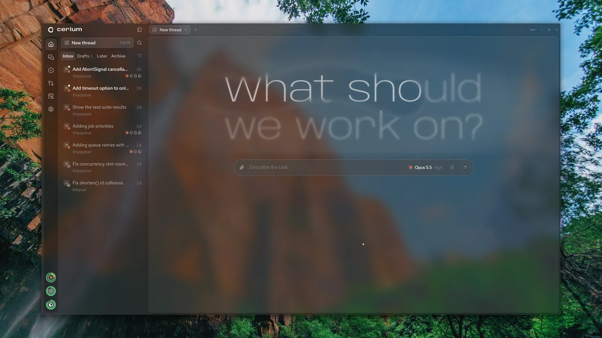
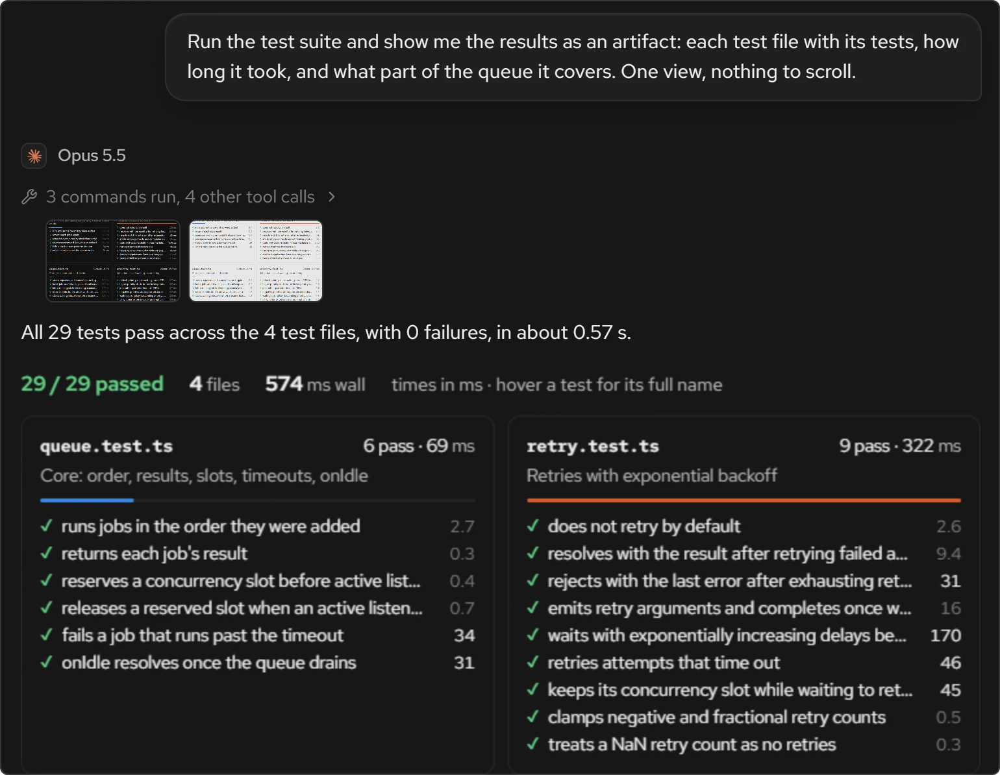
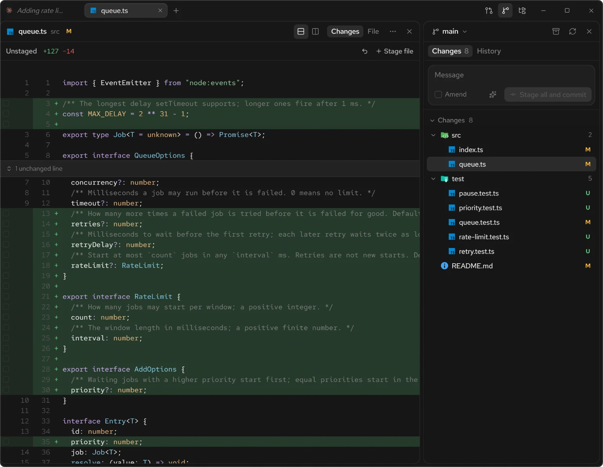
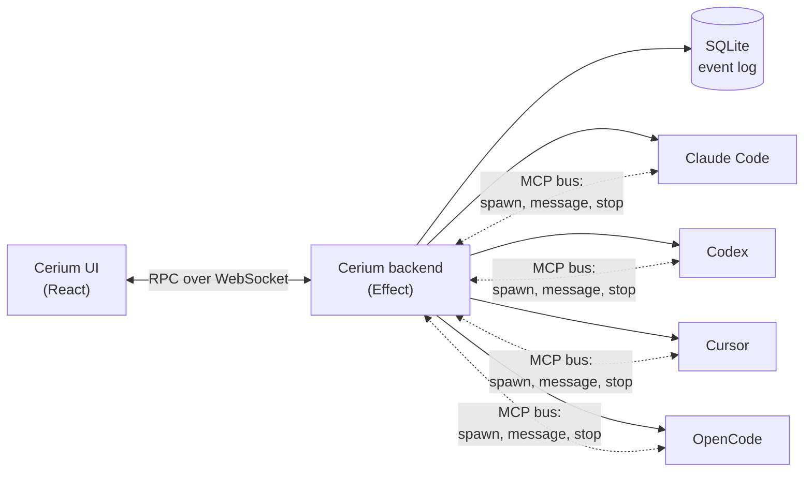

<div align="center">

<br />

<picture>
  <source media="(prefers-color-scheme: dark)" srcset=".github/media/wordmark-dark.svg" />
  <source media="(prefers-color-scheme: light)" srcset=".github/media/wordmark-light.svg" />
  
</picture>

<h3>One thread. Every agent.</h3>

<p>
  <a href="https://github.com/CeriumHQ/cerium/releases"></a>
  <a href="https://github.com/CeriumHQ/cerium/actions/workflows/ci.yml"></a>
  <a href="LICENSE"></a>
  
</p>

<p>
  
  
  
  
</p>

Claude Code, Codex, Cursor and OpenCode side by side. Ask once, and your lead agent hands each
piece of the job to the one that does it best.

[**Download**](https://github.com/CeriumHQ/cerium/releases) ·
[Website](https://cerium.nonlooped.xyz) ·
[Build from source](#build-from-source)

</div>

<br />

<p align="center">
  
</p>

## What it does

<table>
  <tr>
    <td width="50%" valign="top">
      <b>Every harness in one thread</b><br />
      A lead agent hands work to agents from any harness you're signed in to. They run in parallel,
      warn each other before touching the same files, and report back to the lead.
    </td>
    <td width="50%" valign="top">
      <b>The real harnesses, on your plans</b><br />
      Each agent is the harness itself, driven through its official SDK on your own subscription.
      Cerium never sees a token or key.
    </td>
  </tr>
  <tr>
    <td valign="top">
      <b>Answers you can see</b><br />
      Agents answer with charts, tables and timelines drawn right in the conversation.
    </td>
    <td valign="top">
      <b>Undo any turn</b><br />
      Take a thread back to before any message, its files included. Give each thread its own git
      worktree so parallel work never collides.
    </td>
  </tr>
  <tr>
    <td valign="top">
      <b>Git and GitHub beside the thread</b><br />
      Review diffs, stage lines and commit, then work through pull requests and issues without
      leaving the app.
    </td>
    <td valign="top">
      <b>Answer from anywhere</b><br />
      Sign in on your phone and your computer's threads come along, with a notification when an
      agent needs you.
    </td>
  </tr>
</table>

<table>
  <tr>
    <td width="50%" valign="top">
      
    </td>
    <td width="50%" valign="top">
      
    </td>
  </tr>
</table>

## Supported harnesses

| Harness         | Driven through                                      | Sign in                  |
| --------------- | --------------------------------------------------- | ------------------------ |
| **Claude Code** | Claude Agent SDK, running your installed `claude`   | `claude` login           |
| **Codex**       | `codex app-server`, with types from your install    | `codex login`            |
| **Cursor**      | `@cursor/sdk`, running Cursor's agent locally       | Cursor's browser sign-in |
| **OpenCode**    | `@opencode/client`, over a private `opencode serve` | `opencode auth login`    |

Install any of them and sign in as usual; Cerium finds them. OpenCode's free models need no sign-in.
Cerium is an independent project, not affiliated with or endorsed by Anthropic, OpenAI, Anysphere or
Anomaly.

## How it works



Adapters translate each harness's stream into one event schema, stored as an append-only log. Cerium
runs no agent loop of its own: agents spawn and message each other only through an MCP server it
injects into every session, so every agent stays visible in the thread.

## Install

Download the latest build from [Releases](https://github.com/CeriumHQ/cerium/releases):

- **Windows 10 and 11**: run `Cerium-Setup-<version>-x64.exe`, or `-arm64.exe` on an Arm PC.
- **Ubuntu and Debian**: `sudo apt install ./cerium_<version>_amd64.deb` (`arm64` on Arm).
- **Fedora**: `sudo dnf install ./cerium-<version>.x86_64.rpm` (`aarch64` on Arm).
- **Any other Linux**: `chmod +x Cerium-<version>-x86_64.AppImage` (`arm64` on Arm) and run it. It
  needs FUSE 2 (`libfuse2`, or `libfuse2t64` on Ubuntu 24.04 and later).
- **macOS**: open `Cerium-<version>-arm64.dmg` on Apple silicon, or `-x64.dmg` on an
  Intel Mac, and drag Cerium into Applications. Until it is notarized, open it once, then choose
  Open Anyway in System Settings → Privacy & Security.

Cerium is in early development and ships **nightly** builds; it updates itself on the channel you
pick in Settings → Updates.

## Build from source

Requires [Node.js](https://nodejs.org) 24.11+ and [Bun](https://bun.sh) 1.4+.

```sh
git clone https://github.com/CeriumHQ/cerium.git
cd cerium
bun install
bun run dev      # backend, UI and desktop window; --browser for the UI in your browser
bun run verify   # format, lint, typecheck and test, as CI does
```

## Contributing

Bug reports, ideas and pull requests are welcome. Security issues go through a
[private advisory](https://github.com/CeriumHQ/cerium/security/advisories/new), not public issues.

## License

Free and open source under the [Apache License 2.0](LICENSE).
